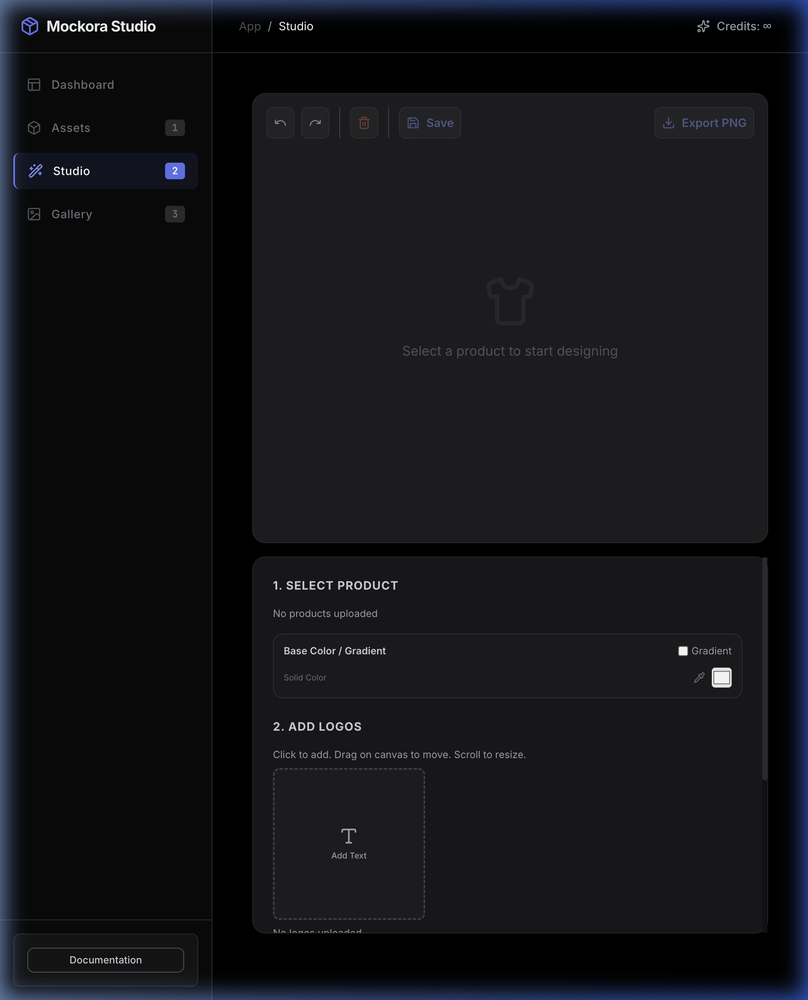

<div align="center">



<p>
  <a href="https://mockora-studio.vercel.app"></a>
  
  
  
</p>

<p><em>Studio-quality product mockups for creators, e-commerce sellers, print-on-demand brands and designers.<br>
Drop your design on a product; AI blends it into the seams, folds, light and shadow.</em></p>

<a href="https://mockora-studio.vercel.app"></a>

</div>


## What it is

Instead of fighting heavy Photoshop templates, place your transparent logo, text or artwork on a canvas, then size and rotate it. Gemini analyses the product's stitching, folds and lighting and composes the design onto it realistically.

| | |
|---|---|
| **AI composition** | Gemini reads seams, folds, light and shadow and blends the design into the product. |
| **Studio canvas** | Layer-based drag and drop, pivot-centred rotation and snapping guides. |
| **Persistent** | Assets, history and drafts are kept in IndexedDB, so a refresh loses nothing. |
| **History and layers** | Unlimited undo / redo and easy z-order changes. |
| **Custom fonts** | Upload `.ttf` / `.otf` files and add live text layers. |
| **Projects** | Export a design as `.json` and load it back later. |
| **Safe keys** | AI calls go through a serverless route, so no API key reaches the browser. |


## Türkçe özet

**Mockora Studio**, içerik üreticileri, e-ticaret satıcıları ve baskı markaları için yapay zekâ destekli bir mockup aracı. Logonu ya da tasarımını tuvale yerleştirip boyutlandırıyor ve döndürüyorsun; Gemini ürünün dikişini, kıvrımını, ışığını ve gölgesini analiz ederek tasarımı gerçekçi biçimde ürüne yediriyor. Tüm çalışma tarayıcıda saklanıyor, projeler JSON olarak dışa aktarılabiliyor.


## Development

```sh
npm install
cp .env.example .env.local   # GEMINI_API_KEY
npm run dev                  # Express + Vite
npm run build
```

```
App.tsx · components/   landing and studio canvas
services/               Gemini client, storage
api/                    serverless AI route
server.ts               local dev server
```

<div align="center">
<br>
<a href="https://github.com/kutluhangil"></a>
<sub>Your design, on any product, in seconds.</sub>
</div>
