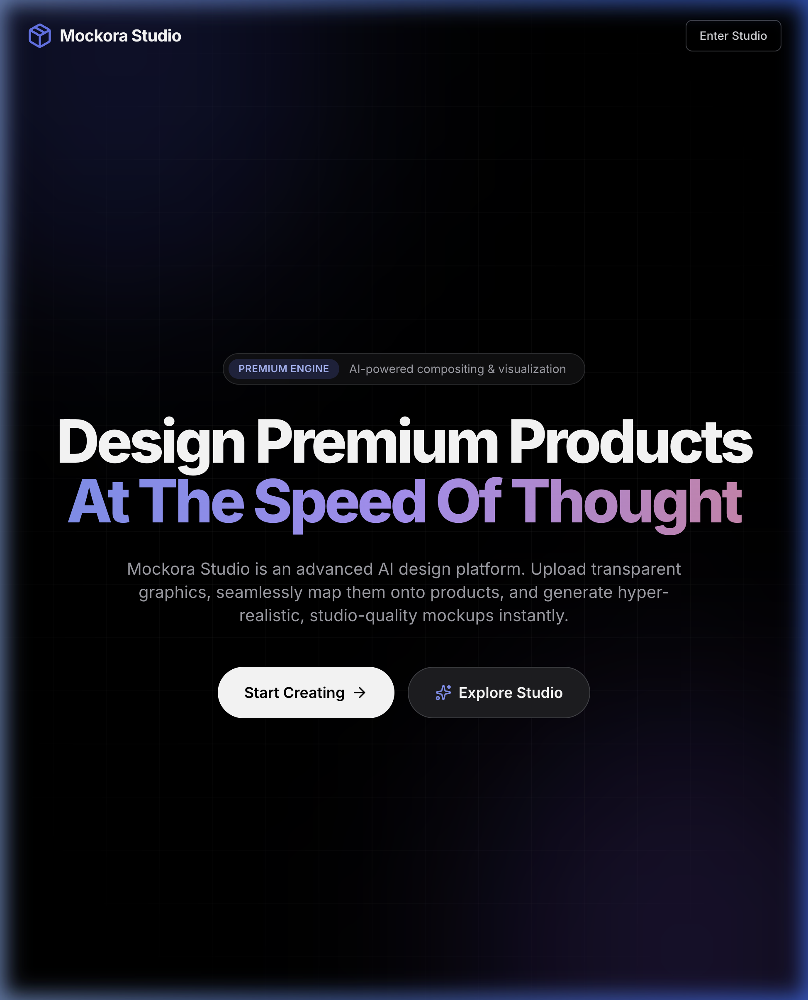
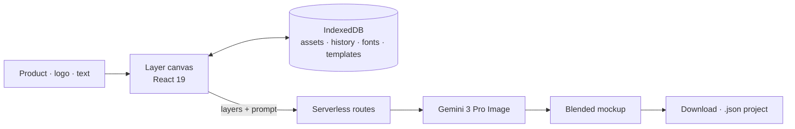

<div align="center">


<p>
  <a href="https://mockora-studio.vercel.app"></a>
  
  
  
</p>

<p><em>Studio-quality product mockups in the browser. Place your logo or artwork on a product,<br>
and Gemini blends it into the seams, folds, light and shadow, as if it had been printed.</em></p>


</div>


## The idea

Mockup templates mean heavy PSD files, smart objects and a lot of patience. Mockora replaces them with three steps: upload (or generate) a product photo and your logo, arrange them on a layer canvas, and let Gemini do the part templates fake: wrap the print around the fabric, bend it with the folds and light it like the photo.

> **Your keys stay on the server, your work stays in the browser.** Every AI call goes through a serverless route that holds the Gemini key. Assets, layers, history, fonts, templates and finished mockups are kept in IndexedDB, so a refresh or a closed tab loses nothing.


## Features

| | |
|---|---|
| **Three-step flow** | Upload assets, compose in the studio, download the result. |
| **Generate assets** | Describe a logo or a product and Gemini creates it as an image to work with. |
| **Remove background** | Cut a logo or product out of its background with one click. |
| **Layer canvas** | Drag, scale and rotate around the layer's own pivot, with snapping guides to the centre lines. |
| **Text layers** | Add live text, including your own uploaded `.ttf` / `.otf` fonts. |
| **Undo / redo** | A full layer history you can step through. |
| **AI composition** | Gemini blends the design into the product's seams, folds, light and shadow. |
| **Realistic preview** | Snapshot the canvas and get a quick photoreal composite before the final render. |
| **Templates** | Save a layout as a template and reuse it on other products. |
| **Projects** | Export a design as `.json` and load it back later; download mockups as images. |
| **Persistent** | Everything lives in IndexedDB via `idb-keyval`. |

<table>
  <tr>
    <td width="50%"></td>
    <td width="50%"></td>
  </tr>
  <tr>
    <td align="center">Landing</td><td align="center">Studio</td>
  </tr>
</table>


## How it fits together



| Route | Does |
|---|---|
| `POST /api/generate-mockup` | Product + layers + prompt → the blended mockup |
| `POST /api/generate-realtime-composite` | Canvas snapshot → a quick realistic preview |
| `POST /api/generate-asset` | Prompt → a logo or a product image |
| `POST /api/remove-background` | Image → the same image without its background |


## Türkçe özet

**Mockora Studio**, içerik üreticileri, e-ticaret satıcıları ve baskı markaları için tarayıcıda çalışan bir mockup aracı. Ürün fotoğrafını ve logonu yükleyip (ya da Gemini'ye ürettirip) katmanlı tuvalde yerleştiriyor, boyutlandırıp döndürüyorsun; Gemini tasarımı ürünün dikişine, kıvrımına, ışığına ve gölgesine yediriyor. Arka plan silme, özel font, geri al / yinele, şablonlar ve JSON proje dışa aktarma var. Anahtar sunucuda kalıyor, tüm çalışma tarayıcıda IndexedDB'de saklanıyor.


## Development

```sh
npm install
cp .env.example .env.local   # GEMINI_API_KEY
npm run dev                  # Express + Vite
npm run build
```

```
App.tsx              landing, dashboard, the three-step studio
components/          file uploader, buttons, dialogs
services/            geminiService: the client for the API routes
api/                 serverless routes (Vercel)
server.ts            local server: the same routes + Vite
```

<div align="center">
<br>
<a href="https://github.com/kutluhangil"></a>
<sub>All rights reserved · the logo and product in the banner are invented.</sub>
</div>
